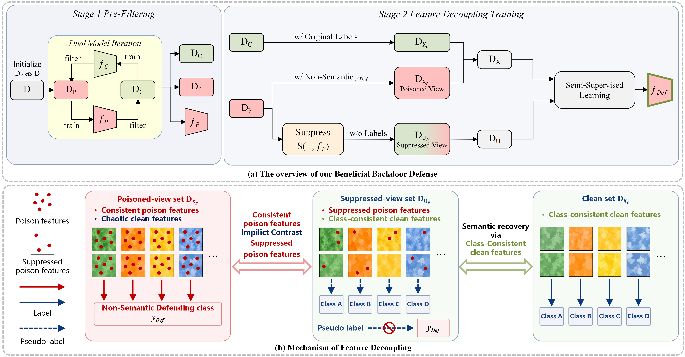

<div align="center">

<h1>BBD</h1>
<h3>Turning Poison into Cure:<br>Beneficial Backdoor Defense via Feature Decoupling Training</h3>

<p>Hongrui Yu · Lu Qi · Hailong Sun</p>

<p>
  <a href="#overview">Overview</a> ·
  <a href="#environment">Environment</a> ·
  <a href="#datasets">Datasets</a> ·
  <a href="#quick-start">Quick Start</a>
</p>

</div>

## Overview

**Beneficial Backdoor Defense (BBD)** learns from suspicious training samples through Feature Decoupling Training: their original poisoned views learn an auxiliary defending class, while suppressed views help recover clean semantic information.

<p align="center">
  
</p>


## Environment

- Linux with an NVIDIA GPU and CUDA support
- Python 3.10.12, PyTorch 2.7.0, torchvision 0.22.0
- NumPy, SciPy, Pillow, OpenCV, tqdm, PyYAML, pandas, and tabulate

## Datasets

**We prepared and packaged the CIFAR-10 attack datasets for this repository.**

[Download from Google Drive](https://drive.google.com/drive/folders/1beyGc4D4FDoiny9mAGtNEUqPxVbmhmcr) · Upload in progress

Place the downloaded `datasets/` folder alongside `BBD_code/`. The default data path is `../datasets`.

## Quick Start

### 1. Install dependencies

Use a Linux environment with an NVIDIA GPU and a CUDA-enabled PyTorch installation. The current MixMatch implementation requires CUDA. Run the following commands from the repository root:

```bash
pip install -r requirements.txt
pip install opencv-python
```

OpenCV is used for inpainting during feature suppression.

### 2. Configure paths and the attack

Edit `dataset_root` and `attack_type_list` in `config/baseline_bbd.yaml` to select your data directory and attacks.

| Parameter | Default | Description |
| :--- | :--- | :--- |
| `dataset_root` | `../datasets` | Directory containing the attack folders. |
| `attack_type_list` | All eight attacks | Attack folder names to run. |
| `dataset_name` | `cifar10` | Dataset used for training and evaluation. |
| `save_root` | `record/` | Output directory for results and model checkpoints. |
| `log_dir` | `record/` | Output directory for logs. |
| `model_name` | `PreActResNet18` | Classification model. |


### 3. Run BBD

```bash
python BBD.py --config config/baseline_bbd.yaml
```

### Outputs

With the configuration above:

| File                                                         | Contents                                                     |
| :----------------------------------------------------------- | :----------------------------------------------------------- |
| `record/results.csv`                                         | Metrics and filtering counts for each stage; use `split_time=semi` for final test results |
| `record/logs.log`                                            | execution log                                                |
| `record/backdoor-defense-model/cifar10/badnet_colorful/PreActResNet18/model_ID_semi.pth.tar` | Final model weights                                          |

**ACC** is clean test accuracy; **ASR** is the fraction of evaluated triggered inputs predicted as the attacker's target. 
